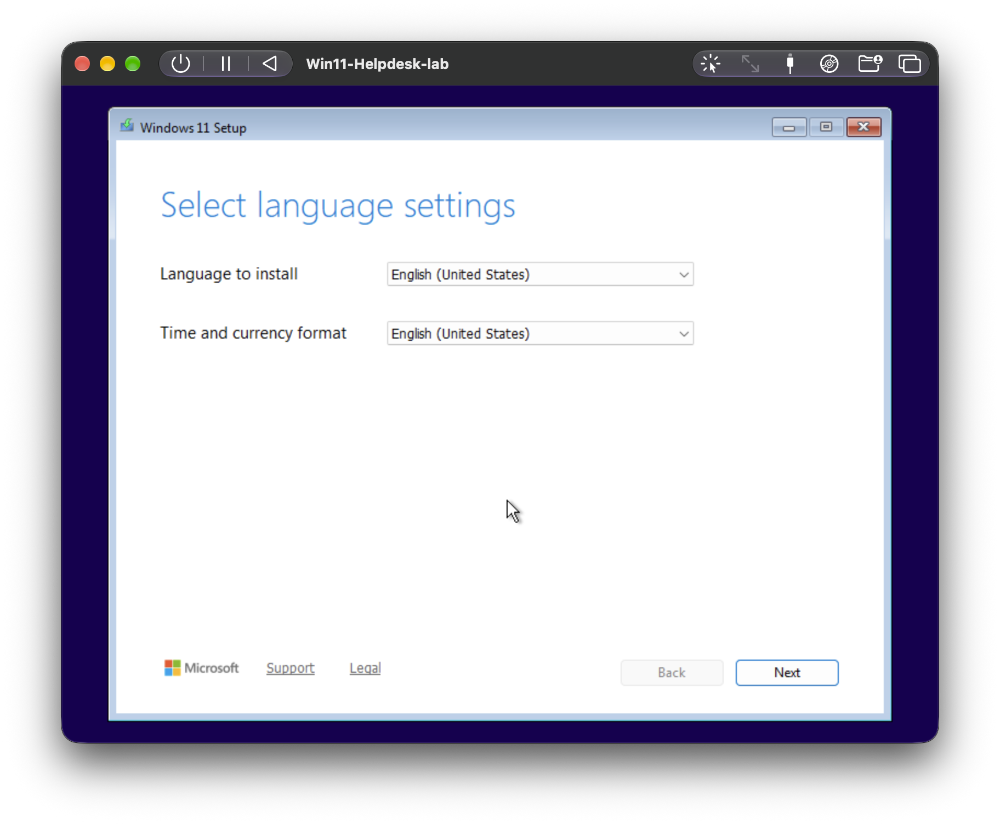
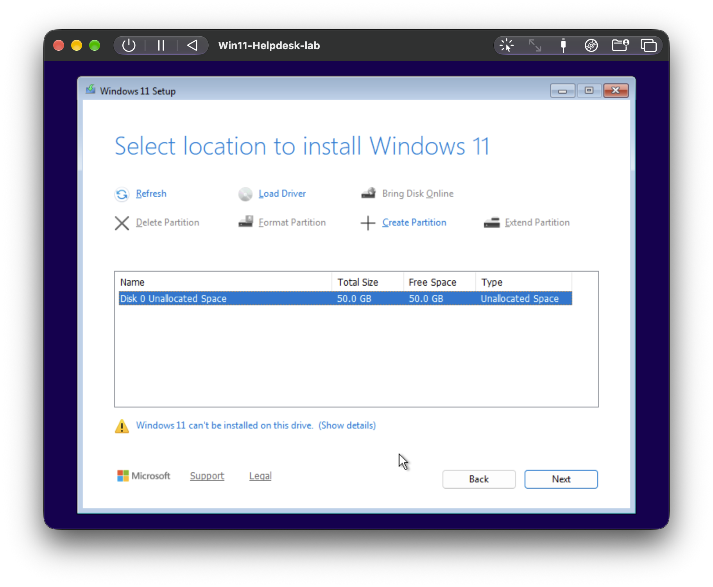
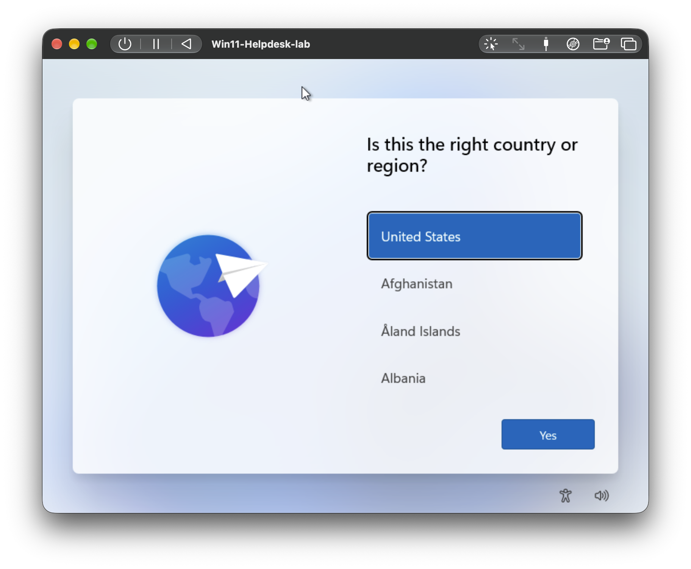
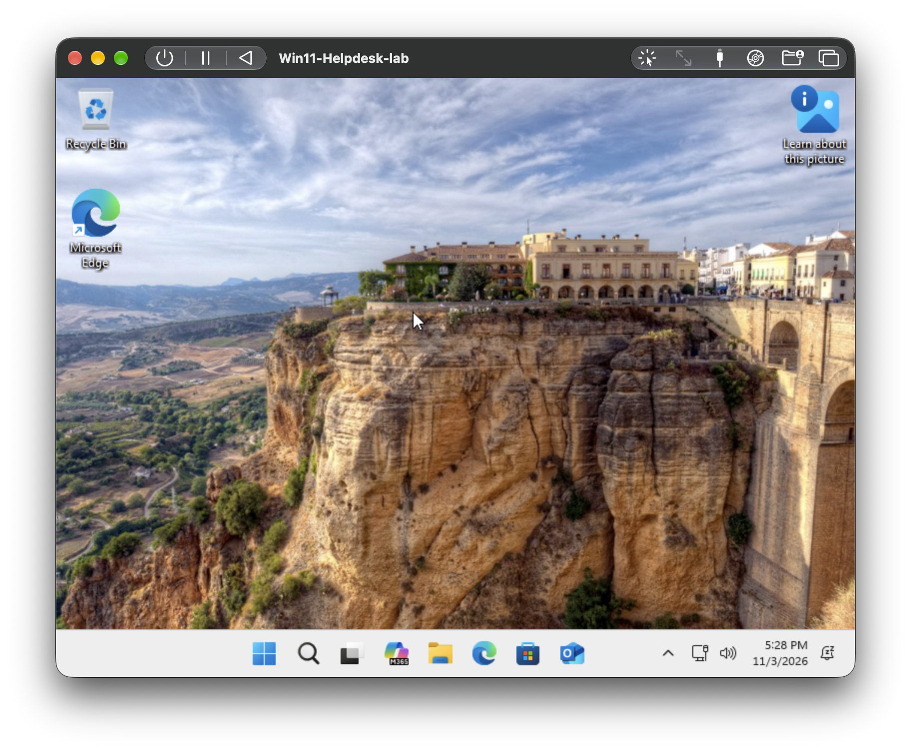
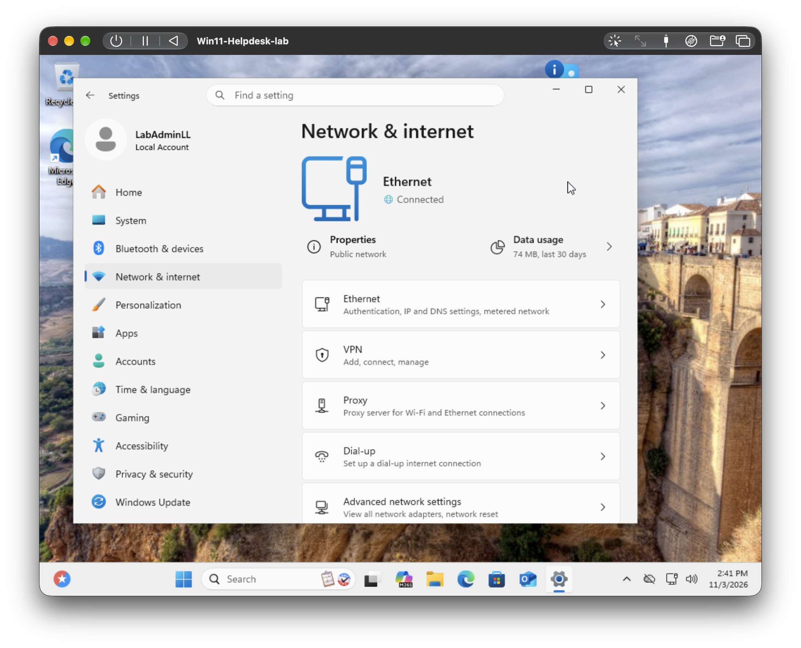
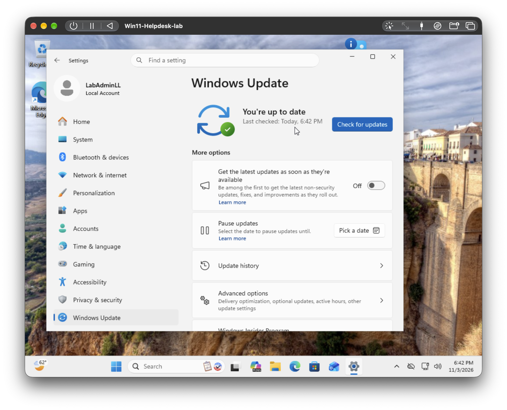

# Project 1: Windows 11 Helpdesk Lab

**Goal:** Build a Windows 11 virtual machine on an Apple silicon Mac, get it fully working, create a restorable backup, then practice real helpdesk troubleshooting on it.

**Tools:** UTM, Windows 11 Pro ARM64 (Microsoft's official ISO), Command Prompt, Event Viewer, Windows Update

---

## 1. Build the VM

1. Downloaded the Windows 11 ARM64 multi-edition ISO from Microsoft's official site.
2. Created a VM in UTM using **Virtualize** mode, 4 GB RAM, 2 CPU cores, 50 GB disk, with UTM guest tools enabled.
3. Installed Windows 11 Pro using a local account.

### Issue: "Windows 11 can't be installed on this drive"
The installer warned that the disk needed to be at least 52 GB. I opened **Show details** to read the exact requirement, and since the installer still allowed me to continue, I proceeded. The install completed without errors.

**Lesson:** read the full error message before acting. A 64 GB disk would have avoided the warning entirely.

## 2. Fix the missing network driver

After install, the taskbar showed no network icon and Windows had no connection.

- **Cause:** Windows had no driver for the VM's virtual network card.
- **Fix:** Installed the UTM guest tools from the mounted disc, then restarted.
- **Verification:** Internet worked and Settings showed Ethernet as **Connected**. The taskbar icon stayed hidden, which I treated as cosmetic after verifying the real connection state in Settings.

## 3. Update Windows and create a clean backup

Ran Windows Update until it reported the system was up to date, shut Windows down properly, then cloned the VM in UTM as a clean backup that I never boot or modify.

## 4. Break/fix scenarios

| Scenario | Write-up |
|---|---|
| VM crash and recovery from backup | [crash-recovery.md](crash-recovery.md) |
| Websites won't load (DNS) | [dns-troubleshooting.md](dns-troubleshooting.md) |
| Locked-out user (account unlock and password reset) | [locked-out-user.md](locked-out-user.md) |
| More to come | |

## What I learned
- Reading exact error messages, and checking details before changing anything.
- Verifying the real state (Settings, `ipconfig`) rather than trusting an icon.
- Always working from a restorable backup before breaking things on purpose.
- Documenting what did not work along with what did.
