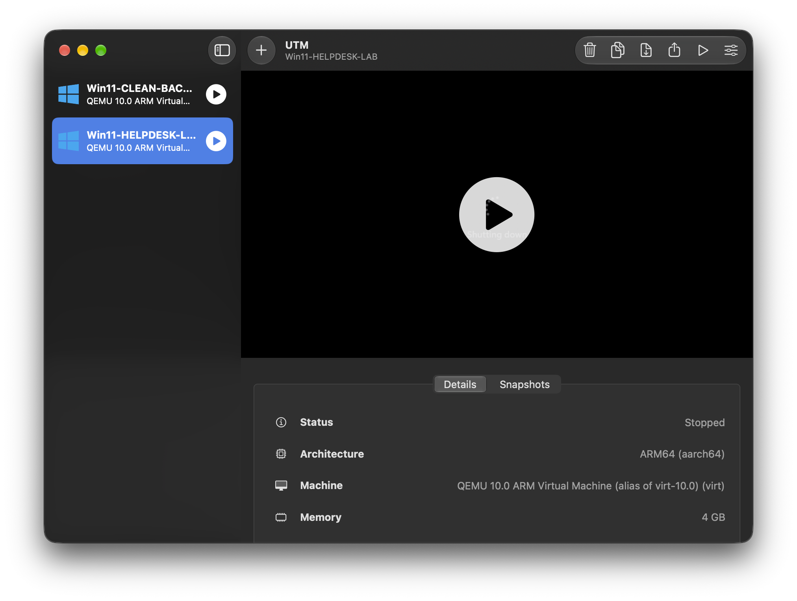

# Scenario: VM crash and recovery from backup

**Environment:** Windows 11 Pro (ARM64) virtual machine in UTM on an Apple silicon MacBook.
**Category:** System crash / boot failure / backup restore

---

## Ticket
While practicing a break/fix scenario, I tried to disable the Ethernet adapter. The whole VM shut down, and after it came back it would not boot to Windows.

## Symptoms
- Clicking **Disable** on the Ethernet adapter in Network Connections shut the VM down immediately. The VM restarted to the UTM boot logo.
- The same crash happened on a second attempt, so it was reproducible.
- After force-stopping the VM, Windows showed an error that it could not recover, with more recovery options.
- Error code shown: **[FILL IN: code from your screenshot, or "none shown"]**

## Diagnosis steps
1. Confirmed I was working in the lab VM and not the clean backup.
2. Waited for the VM to finish restarting after the first crash instead of interrupting it.
3. Reproduced the crash a second time to confirm it was tied to disabling the adapter, then stopped testing that action.
4. Checked Event Viewer (System log) for Critical or Error entries near the crash time.
   - Result: **[FILL IN: e.g. Kernel-Power Event ID 41, or "did not find an entry"]**
5. Opened the advanced recovery options and tried **Startup Repair**.
   - Result: **[FILL IN: Startup Repair worked / failed]**

## Root cause
Two likely causes, and I did not prove either:
- Disabling the adapter appears to crash the VM's virtual network driver, which is reproducible in this setup.
- A forced shutdown in the middle of a crash can leave Windows boot files in a damaged state.

## Fix
**[FILL IN: choose one and delete the other]**
- Startup Repair completed and Windows booted normally, **or**
- Deleted the broken VM and cloned the clean backup into a new lab VM, then confirmed it booted and the internet worked. 

## Verification
- Windows booted to the desktop and I could log in.
- Edge loaded a website.

## Notes and lessons learned
- **Backups are what make a lab safe.** I made the clean clone before breaking anything, so recovery took minutes instead of a reinstall.
- **Stop repeating an action that crashes the system.** After the second crash I stopped and used a different method to simulate a network problem (see [dns-troubleshooting.md](dns-troubleshooting.md)).
- **Shut down from inside Windows** (Start > Power > Shut down) rather than using the VM stop button, except in an emergency.
- **Avoid force-stopping during writes.** Hard stops risk corrupting boot files.
