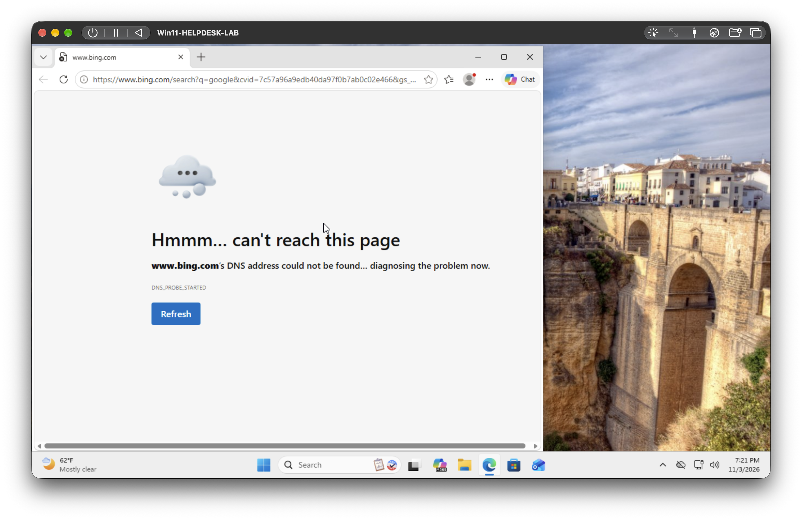
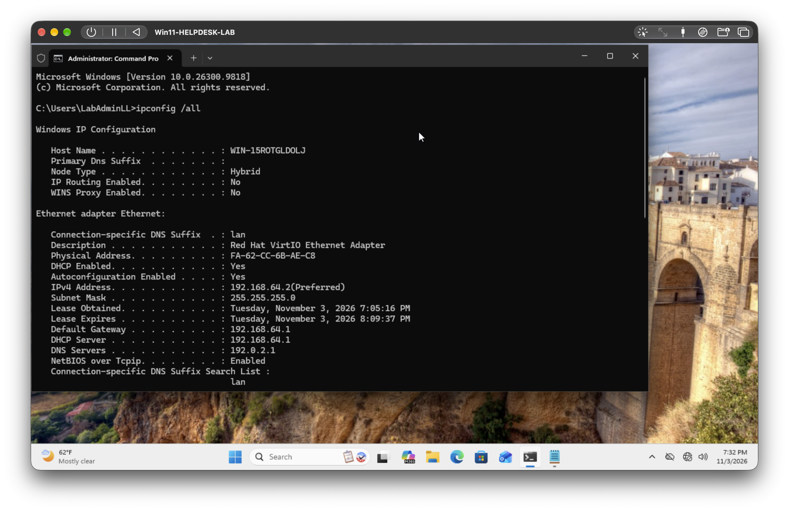
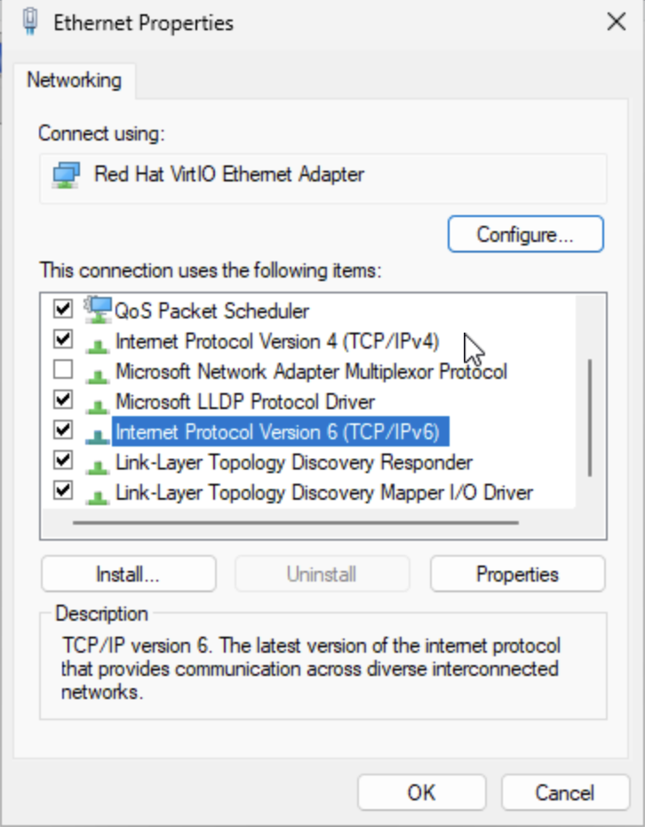
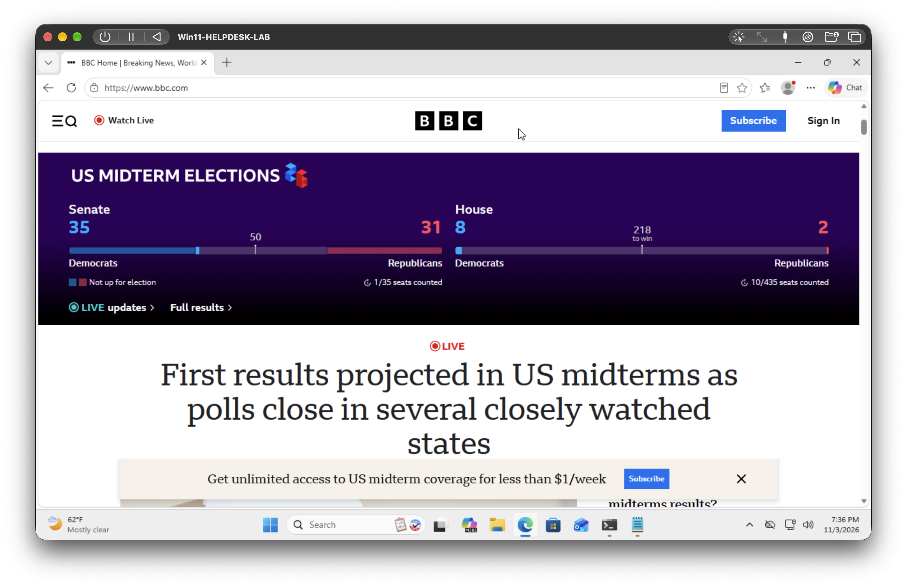
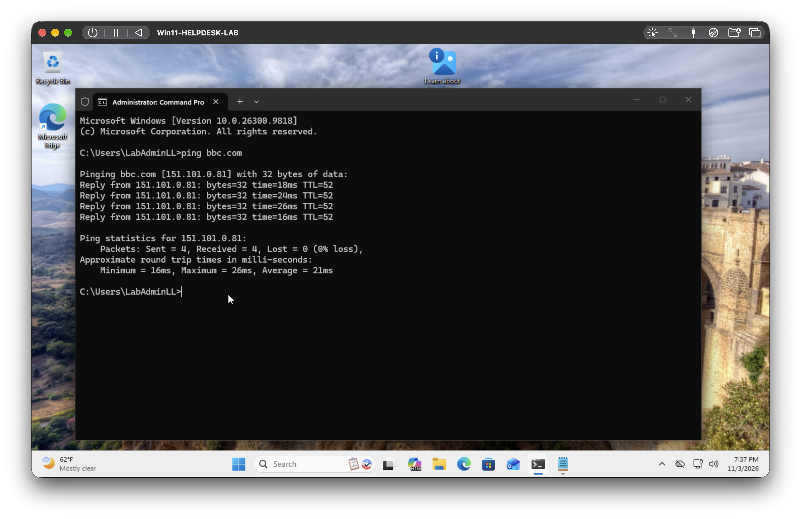

# Scenario 1: "I can't open any websites, but Teams says it's connected"

**Environment:** Windows 11 Pro (ARM64) virtual machine running in UTM on an Apple silicon MacBook.
**Category:** Network / DNS troubleshooting
**Priority (simulated):** Medium, user cannot browse but other apps appear connected

---

## Ticket
User reports: "I can't open any websites, but Teams says it's connected."

## Symptoms
- Edge shows a "can't reach this page" / DNS error when loading sites. 
- Ethernet shows as Connected in Settings, so the adapter itself is up.

## Diagnosis steps
1. Ran `ipconfig /all` to check the IP address, gateway, and DNS server on the adapter.
   - Result: The adapter had a valid IP (`192.168.64.2`), subnet mask, and default gateway (`192.168.64.1`) from DHCP, but the **DNS server was `192.0.2.1`**, not the gateway or an address handed out by DHCP.
2. Ran `ping 8.8.8.8` to test raw connectivity to the internet by IP.
   - Result: 4 of 4 replies, 0% loss, about 25 ms average. The internet connection itself was working.
3. Ran `ping bbc.com` to test name resolution.
   - Result: "Ping request could not find host bbc.com. Please check the name and try again."
4. Ran `nslookup bbc.com` to see which DNS server was being asked and whether it answered.
   - Result: "DNS request timed out" repeatedly, with the server shown as `UnKnown` at address `192.0.2.1`, ending in "Request to UnKnown timed-out." The configured DNS server was not answering.

Conclusion: connectivity by IP address worked, but name lookups failed, which points to DNS rather than the network connection itself.

## Root cause
The network adapter was configured with an invalid DNS server (`192.0.2.1`), a reserved address that never answers, so hostnames could not be resolved.

## Fix
1. Opened `ncpa.cpl` > Ethernet > Properties > IPv4 > Properties.
2. Set **Obtain DNS server address automatically**.
3. Re-enabled IPv6 on the adapter (see notes).
4. Ran `ipconfig /flushdns` to clear cached lookups.

## Verification
- `ping bbc.com` returned replies.
- Edge loaded websites normally.

## Notes and lessons learned
- **My first attempt did not reproduce the symptom.** After setting the bad IPv4 DNS server, websites still loaded. I verified the setting had saved with `ipconfig /all`, flushed the DNS cache, and tested with a site I had never visited.
- **IPv6 was bypassing the broken IPv4 DNS setting.** Sites only failed once I unchecked IPv6 on the adapter. A browser's own Secure DNS setting can also bypass Windows DNS, so it is worth checking when a DNS change seems to have no effect.
- **Cached lookups can hide DNS problems.** Previously visited sites kept loading, so testing with a never-visited site and with `nslookup` was more reliable than the browser.
- **Tip for the user:** if websites fail but other apps work, report it as a possible DNS issue. Restarting the router or PC often clears it, but `ipconfig /flushdns` is the quick check.
- **Commands used:** `ncpa.cpl`, `ipconfig /all`, `ipconfig /flushdns`, `ping`, `nslookup`.
