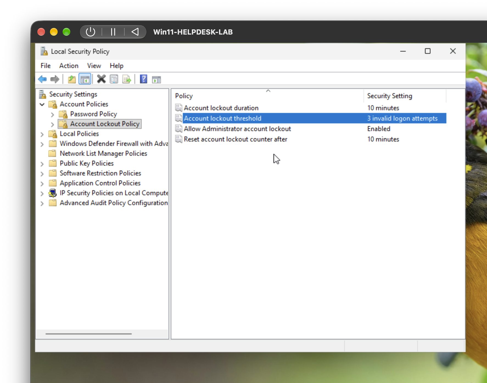
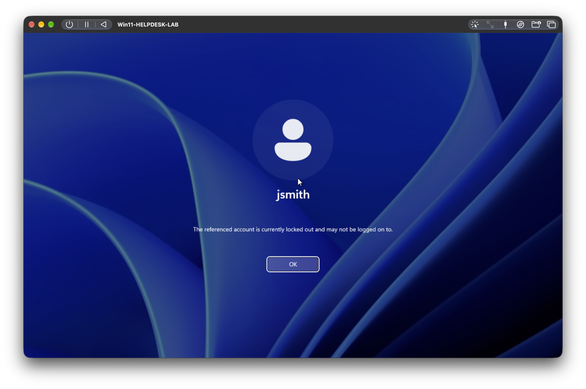
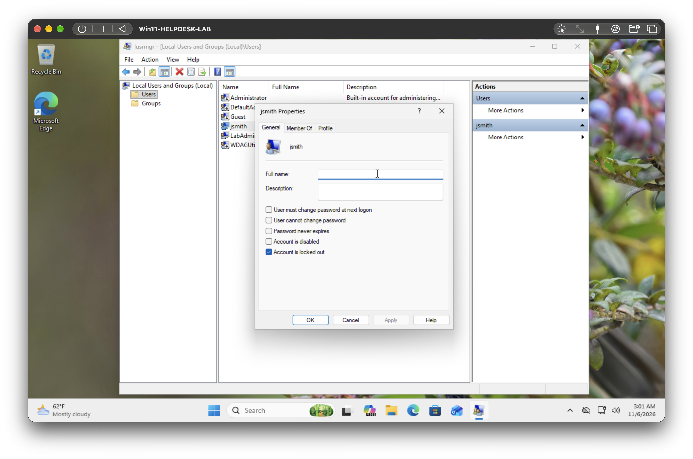
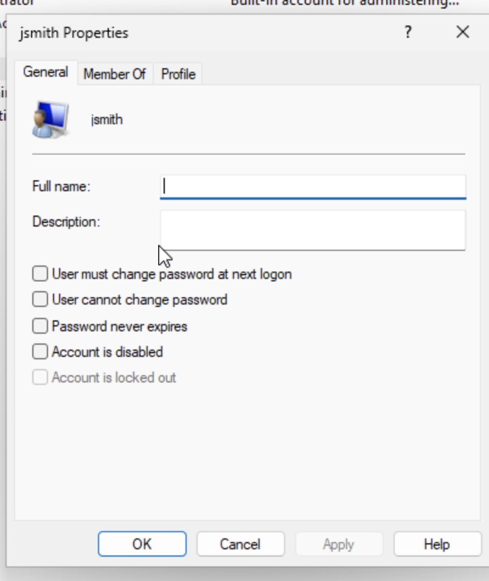
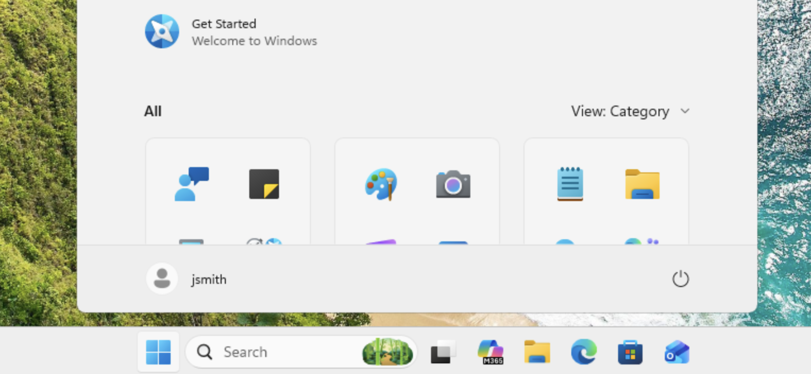

# Scenario 2: "I can't log in. It says my account is locked."

**Environment:** Windows 11 Pro (ARM64) virtual machine running in UTM on an Apple silicon MacBook, using local accounts.
**Category:** Account management / access
**Priority (simulated):** High, the user cannot work until access is restored

---

## Setup
To reproduce a realistic lockout, I created a test user (`jsmith`) and turned on an account lockout policy:
- Created the account from an elevated Command Prompt with `net user`.
- In **Local Security Policy > Account Policies > Account Lockout Policy**, set **Account lockout threshold to 3 invalid attempts**, and accepted the suggested 30-minute lockout duration and reset counter.

## Ticket
User reports: "I can't log in to my computer. It says my account is locked."

## Symptoms
- After three incorrect password attempts, the sign-in screen reported that the account was locked out and refused further sign-in attempts. 

## Diagnosis steps
1. Confirmed the symptom: the sign-in screen showed the account as locked out, not just a wrong password.
2. Signed in with an administrator account and opened **Local Users and Groups** (`lusrmgr.msc`).
3. Opened the user's properties and checked the **"Account is locked out"** box.
   - Result: the box was checked, confirming the account was locked and not disabled or deleted. 

## Root cause
Three consecutive failed sign-in attempts met the lockout threshold set by the account lockout policy, so Windows locked the account. By default it would unlock itself after 30 minutes, but the user needed access sooner.

## Fix
1. In `lusrmgr.msc`, opened the user's properties and **unchecked "Account is locked out."** 
2. Because a locked-out user has usually forgotten the password, I also reset it: right-click the user > **Set Password**, and entered a temporary password.
3. Checked **"User must change password at next logon"** so only the user knows the final password.

## Verification
- Signed in as the user with the temporary password.
- Windows required a password change, which I completed.
- Reached the desktop successfully. 

## Notes and lessons learned
- **Verify identity first.** In a real environment, I would confirm the caller is who they say they are before unlocking or resetting anything: call back on a number on file, ask verification questions, or get manager approval. Account resets are a common social-engineering target.
- **Locked out is not the same as disabled.** A locked account clears with a timer or an admin unlock. A disabled account stays off until someone re-enables it. Checking which one it is tells you the right fix.
- **Resetting a local password has a cost.** Windows warns that resetting another user's local password can make encrypted files and saved credentials unreadable. That's harmless in a lab but matters on a real work computer.
- **Prevention.** Tell the user to check Caps Lock and the keyboard layout before retrying, and to stop after two failures instead of triggering the lock. In a managed environment, self-service password reset would let users fix this themselves (covered in my planned identity project).
- **Tools and commands used:** `net user`, Local Security Policy (`secpol.msc`), Local Users and Groups (`lusrmgr.msc`).
